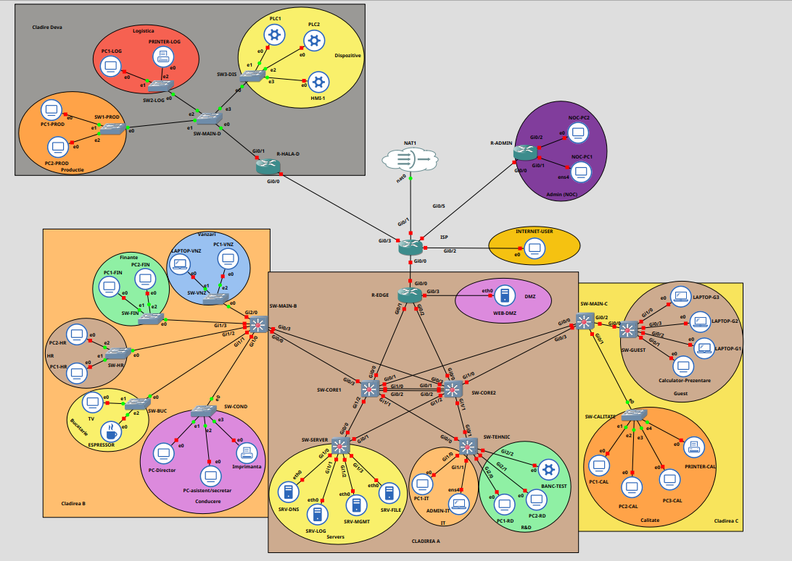

# Design, Implementation and Automation of an Enterprise Network in GNS3

> Bachelor's thesis project (working title) · Marian Flavius-Andrei

## About

This project builds the complete network of a medium-sized company in **GNS3**, treated as a **product delivered to a client**: design, implementation, hardening and administration. Network configuration and administration are automated with a **Python** application.

The topology is designed from scratch. It started from the network built during a summer internship, but the design here is far more complex: multiple buildings, a remote production site, redundancy, per-department segmentation and management services.

## Scenario

The company (fictional, name TBD) is an **automotive supplier** with a headquarters campus of three buildings and a remote production hall. The network was designed and is maintained by an external **integrator**, who manages it remotely from its own NOC.

|Zone|Location|Contents|
|---|---|---|
|**Building A** (technical HQ)|HQ campus|Network core, servers, DMZ, Internet edge, IT, R&D|
|**Building B** (administrative)|HQ campus|Management, HR, Finance, Sales, kitchen (IoT)|
|**Building C**|HQ campus|Quality, Guest (visitors)|
|**Hall D**|Remote site (Deva)|Production, Logistics, OT devices (PLCs, HMI)|
|**Admin (NOC)**|Integrator's office|Remote network administration via VPN|
|**ISP**|Provider|Simulated Internet service provider, real Internet access via NAT|

## Architecture

- **Hierarchical campus:** Building A hosts a redundant _collapsed core_ (two L3 switches with EtherChannel and HSRP). Buildings B and C each have an L3 distribution switch connected to **both** core switches over routed links (OSPF).
- **Each department has its own VLAN and subnet.** Inter-department traffic is routed on the L3 switches and controlled with ACLs.
- **Risk-based access layer:** zones with a security role (servers, IT/R&D, Guest) use Cisco access switches with full L2 security; low-risk office zones use simple switches with one VLAN per switch, to save resources.
- **The edge router (R-EDGE)** handles Internet access, NAT/PAT, static NAT for the DMZ and perimeter filtering.
- **Hall D** has its own router, using _router-on-a-stick_ for inter-VLAN routing, and an isolated OT network.
- **Remote sites** (Hall D, Admin NOC) reach the headquarters through the ISP over VPN tunnels.

## Current topology

### Devices

|Role|Platform|Count|
|---|---|---|
|Routers (R-EDGE, ISP, R-HALA-D, R-ADMIN)|Cisco IOSv 15.9(3)M6|4|
|Managed switches (core, distribution, servers, IT/R&D, Guest)|Cisco IOSvL2 15.2|7|
|Simple switches (office departments, Hall D)|GNS3 Ethernet switch|10|
|Servers (SRV-DNS, SRV-LOG, SRV-MGMT, SRV-FILE, WEB-DMZ)|Docker `debian:bookworm`|5|
|Full Linux hosts (ADMIN-IT, NOC-PC1)|Debian 12.6 (QEMU)|2|
|End hosts (PCs, laptops, printers, IoT, PLCs, HMI, test bench)|VPCS|32|
|Internet access|GNS3 NAT node|1|

With everything running, the lab uses about **9.5 GB of RAM**.

## Port mapping

Generated from the GNS3 project file. Cisco ports are `GiX/Y`; GNS3 simple switch ports are `eX`.

### Internet and ISP

|Device|Port|Connected to|Remote port|
|---|---|---|---|
|ISP|Gi0/0|R-EDGE|Gi0/0|
|ISP|Gi0/1|NAT1 (real Internet)|nat0|
|ISP|Gi0/2|INTERNET-USER|e0|
|ISP|Gi0/3|R-HALA-D|Gi0/0|
|ISP|Gi0/4|_free_||
|ISP|Gi0/5|R-ADMIN|Gi0/0|
|ISP|Gi0/6 – Gi0/7|_free_||

### Building A

#### Edge and core

|Device|Port|Connected to|Remote port|
|---|---|---|---|
|R-EDGE|Gi0/0|ISP|Gi0/0|
|R-EDGE|Gi0/1|SW-CORE1|Gi0/0|
|R-EDGE|Gi0/2|SW-CORE2|Gi0/0|
|R-EDGE|Gi0/3|WEB-DMZ|eth0|
|SW-CORE1|Gi0/0|R-EDGE|Gi0/1|
|SW-CORE1|Gi0/1|SW-CORE2|Gi0/1 _(EtherChannel)_|
|SW-CORE1|Gi0/2|SW-CORE2|Gi0/2 _(EtherChannel)_|
|SW-CORE1|Gi0/3|SW-MAIN-B|Gi0/0|
|SW-CORE1|Gi1/0|SW-MAIN-C|Gi0/0|
|SW-CORE1|Gi1/1|SW-TEHNIC|Gi0/0|
|SW-CORE1|Gi1/2|SW-SERVER|Gi0/0|
|SW-CORE2|Gi0/0|R-EDGE|Gi0/2|
|SW-CORE2|Gi0/1|SW-CORE1|Gi0/1 _(EtherChannel)_|
|SW-CORE2|Gi0/2|SW-CORE1|Gi0/2 _(EtherChannel)_|
|SW-CORE2|Gi0/3|SW-MAIN-B|Gi0/3|
|SW-CORE2|Gi1/0|SW-MAIN-C|Gi0/3|
|SW-CORE2|Gi1/1|SW-TEHNIC|Gi0/1|
|SW-CORE2|Gi1/2|SW-SERVER|Gi0/1|

#### Servers (SW-SERVER)

|Port|Connected to|Remote port|
|---|---|---|
|Gi0/0|SW-CORE1|Gi1/2|
|Gi0/1|SW-CORE2|Gi1/2|
|Gi1/0|SRV-DNS|eth0|
|Gi1/1|SRV-LOG|eth0|
|Gi1/2|SRV-MGMT|eth0|
|Gi1/3|SRV-FILE|eth0|

#### IT and R&D (SW-TEHNIC)

|Port|Connected to|Remote port|Zone|
|---|---|---|---|
|Gi0/0|SW-CORE1|Gi1/1|uplink|
|Gi0/1|SW-CORE2|Gi1/1|uplink|
|Gi1/0|PC1-IT|e0|IT|
|Gi1/1|ADMIN-IT|ens4|IT|
|Gi2/0|PC1-RD|e0|R&D|
|Gi2/1|PC2-RD|e0|R&D|
|Gi2/2|BANC-TEST|e0|R&D|

#### DMZ

|Device|Port|Connected to|Remote port|
|---|---|---|---|
|WEB-DMZ|eth0|R-EDGE|Gi0/3|

### Building B

#### Distribution (SW-MAIN-B)

|Port|Connected to|Remote port|Zone|
|---|---|---|---|
|Gi0/0|SW-CORE1|Gi0/3|uplink|
|Gi0/3|SW-CORE2|Gi0/3|uplink|
|Gi1/0|SW-COND|e0|Management|
|Gi1/1|SW-BUC|e0|Kitchen (IoT)|
|Gi1/2|SW-HR|e0|HR|
|Gi1/3|SW-FIN|e0|Finance|
|Gi2/0|SW-VNZ|e0|Sales|

#### Department switches

|Switch|Port|Connected to|Remote port|
|---|---|---|---|
|SW-COND|e0|SW-MAIN-B|Gi1/0|
|SW-COND|e1|PC-Director|e0|
|SW-COND|e2|PC-asistent/secretar|e0|
|SW-COND|e3|Imprimanta|e0|
|SW-HR|e0|SW-MAIN-B|Gi1/2|
|SW-HR|e1|PC1-HR|e0|
|SW-HR|e2|PC2-HR|e0|
|SW-FIN|e0|SW-MAIN-B|Gi1/3|
|SW-FIN|e1|PC1-FIN|e0|
|SW-FIN|e2|PC2-FIN|e0|
|SW-VNZ|e0|SW-MAIN-B|Gi2/0|
|SW-VNZ|e1|LAPTOP-VNZ|e0|
|SW-VNZ|e2|PC1-VNZ|e0|
|SW-BUC|e0|SW-MAIN-B|Gi1/1|
|SW-BUC|e1|TV|e0|
|SW-BUC|e2|ESPRESSOR|e0|

### Building C

#### Distribution (SW-MAIN-C)

|Port|Connected to|Remote port|Zone|
|---|---|---|---|
|Gi0/0|SW-CORE1|Gi1/0|uplink|
|Gi0/1|SW-CALITATE|e0|Quality|
|Gi0/2|SW-GUEST|Gi0/0|Guest|
|Gi0/3|SW-CORE2|Gi1/0|uplink|

#### Quality (SW-CALITATE)

|Port|Connected to|Remote port|
|---|---|---|
|e0|SW-MAIN-C|Gi0/1|
|e1|PC1-CAL|e0|
|e2|PC2-CAL|e0|
|e3|PC3-CAL|e0|
|e4|PRINTER-CAL|e0|

#### Guest (SW-GUEST)

|Port|Connected to|Remote port|
|---|---|---|
|Gi0/0|SW-MAIN-C|Gi0/2|
|Gi0/1|Calculator-Prezentare|e0|
|Gi0/2|LAPTOP-G1|e0|
|Gi0/3|LAPTOP-G2|e0|
|Gi1/0|LAPTOP-G3|e0|

### Hall D (Deva)

#### Router and distribution

|Device|Port|Connected to|Remote port|
|---|---|---|---|
|R-HALA-D|Gi0/0|ISP|Gi0/3|
|R-HALA-D|Gi0/1|SW-MAIN-D|e0 _(trunk, router-on-a-stick)_|
|SW-MAIN-D|e0|R-HALA-D|Gi0/1|
|SW-MAIN-D|e1|SW1-PROD|e0|
|SW-MAIN-D|e2|SW2-LOG|e0|
|SW-MAIN-D|e3|SW3-DIS|e0|

#### Zone switches

|Switch|Port|Connected to|Remote port|Zone|
|---|---|---|---|---|
|SW1-PROD|e0|SW-MAIN-D|e1|uplink|
|SW1-PROD|e1|PC1-PROD|e0|Production|
|SW1-PROD|e2|PC2-PROD|e0|Production|
|SW2-LOG|e0|SW-MAIN-D|e2|uplink|
|SW2-LOG|e1|PC1-LOG|e0|Logistics|
|SW2-LOG|e2|PRINTER-LOG|e0|Logistics|
|SW3-DIS|e0|SW-MAIN-D|e3|uplink|
|SW3-DIS|e1|PLC1|e0|OT|
|SW3-DIS|e2|PLC2|e0|OT|
|SW3-DIS|e3|HMI-1|e0|OT|

### Admin (NOC)

|Device|Port|Connected to|Remote port|
|---|---|---|---|
|R-ADMIN|Gi0/0|ISP|Gi0/5|
|R-ADMIN|Gi0/1|NOC-PC1|ens4|
|R-ADMIN|Gi0/2|NOC-PC2|e0|

## Scope (CCNA modules 1–3)

|Stage|Contents|
|---|---|
|**ITN**|IPv4 addressing plan with VLSM, basic configuration and hardening (SSH), static and default routes, DHCPv4 (server and relay)|
|**SRWE**|VLANs and 802.1Q trunks, inter-VLAN routing (SVIs and router-on-a-stick), Rapid PVST+, PortFast, BPDU guard, EtherChannel (LACP), HSRP, port security, DHCP snooping|
|**ENSA**|OSPF (possibly multi-area), standard/extended/named ACLs, NAT/PAT and static NAT, NTP, syslog, SNMP, CDP/LLDP, site-to-site VPN (GRE/IPsec)|
|**Optional**|Dedicated DMZ firewall, BGP towards the ISP, QoS (theoretical)|
|**Extension**|IPv6 dual-stack and an analysis of IPv6-specific security risks|

Wireless is out of scope, since GNS3 does not simulate it well.

## Python automation

An application that:

- **generates** device configurations from templates;
- **pushes** configurations to devices over SSH;
- **backs up** configurations periodically;
- **verifies** network state (interfaces, OSPF neighbors, connectivity).

It is developed on ADMIN-IT (inside the company) and then run from NOC-PC1 (the integrator's office) over the VPN.

## Tech stack

- **GNS3** for simulation
- **Cisco IOSvL2** (managed L2/L3 switches) and **IOSv** (routers); IOL as a lighter option for the final build
- **GNS3 Ethernet switch** for simple access switches
- **VPCS** for end hosts, **Debian 12** for servers and admin stations (Docker and QEMU)
- **Python** for automation

## Status

- [x] Project proposal approved
- [x] Overall architecture defined
- [x] Buildings A, B and C placed and cabled in GNS3
- [x] Internet edge (R-EDGE, ISP, NAT) and DMZ placed
- [x] Hall D (Deva) and Admin NOC placed
- [ ] Addressing plan and VLANs
- [ ] Staged configuration (ITN → SRWE → ENSA)
- [ ] VPN to Hall D and Admin NOC
- [ ] Python application
- [ ] Optional extensions and IPv6
- [ ] Thesis write-up